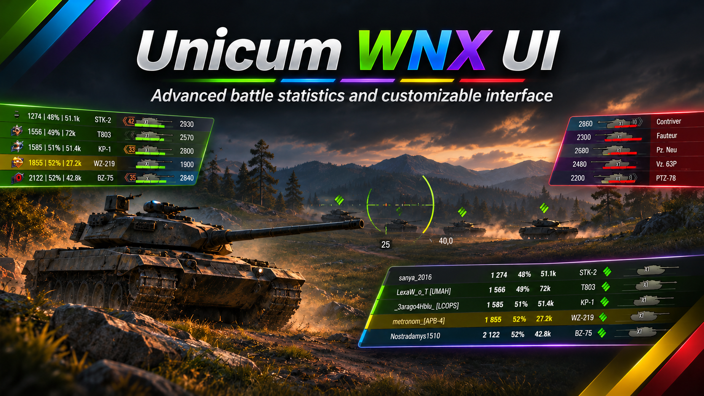
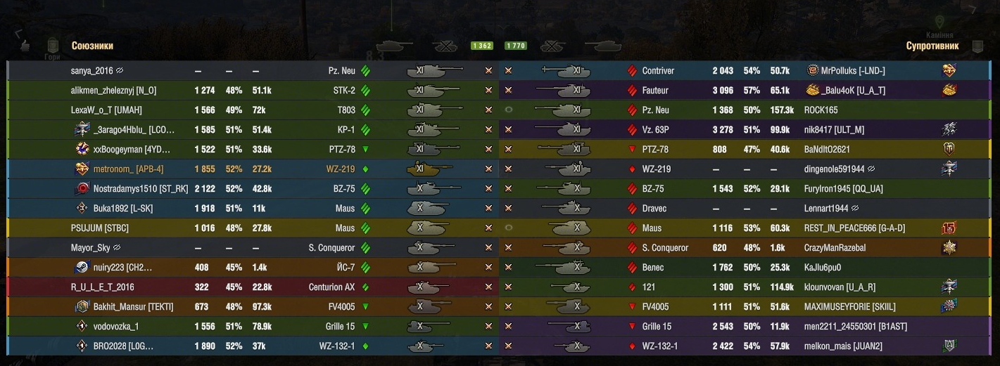
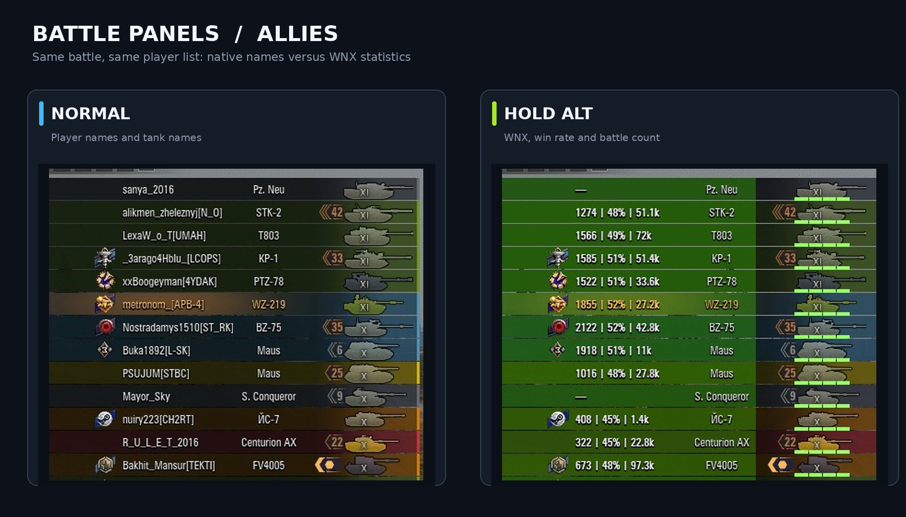
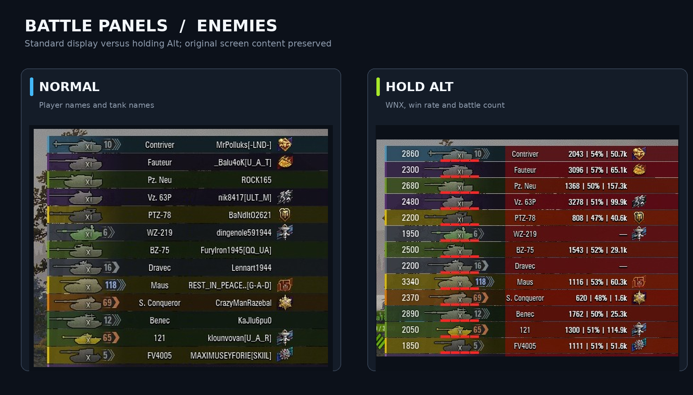
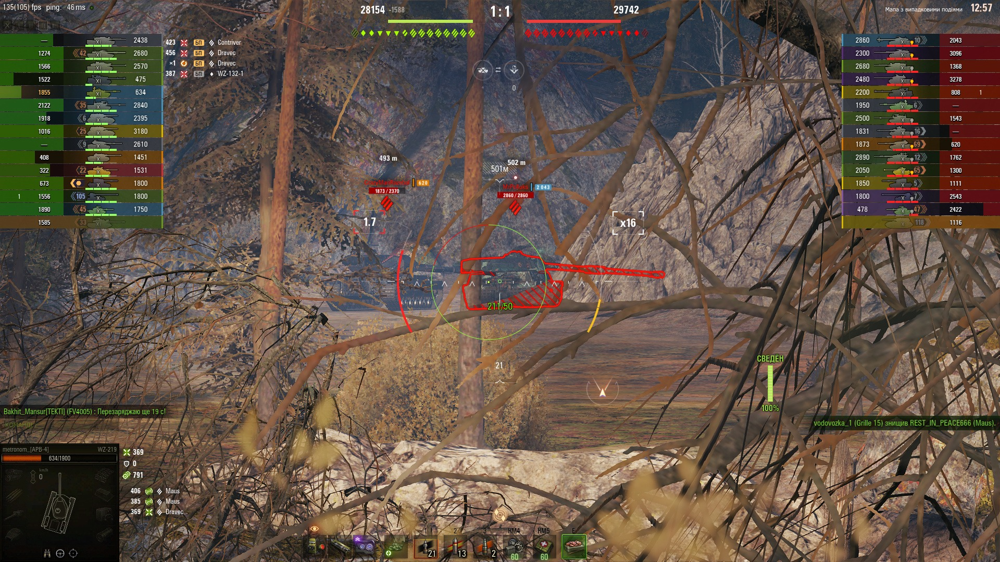

# Unicum WNX UI

**Advanced battle statistics. A cleaner, customizable World of Tanks interface.**

[](https://github.com/gmrkinichuk-gif/unicum-wnx-ui/releases/latest)

[](LICENSE)



*Promotional concept artwork above; the screenshots below show the actual in-game interface.*

A community-maintained, **unofficial derivative** of [Unicum.gg's World of Tanks mod](https://github.com/unicum-gg/unicum.gg-mod). This edition emphasizes WNX-coloured battle panels, streamlined statistics and practical in-game controls. It is **not** affiliated with or endorsed by Unicum.gg or Wargaming. The 0.9.18 release traces back to the supplied upstream 0.9.0 source snapshot; see [CHANGELOG](CHANGELOG.md) and [NOTICE](NOTICE). Development involved assistance from ChatGPT (Codex).

**[Download the latest release](https://github.com/gmrkinichuk-gif/unicum-wnx-ui/releases/latest)** · **[0.9.18 installation ZIP](https://github.com/gmrkinichuk-gif/unicum-wnx-ui/releases/download/v0.9.18/unicum.gg_0.9.18_wot_2.4.1.1.zip)** · **[Settings guide](docs/IN_GAME_SETTINGS.md)**

## Screenshots — real gameplay

### Tab scoreboard

At a glance: **WNX · win rate · battles**, WNX-coloured team rows, vehicle contours and native player information.

[](screenshots/tab-scoreboard-full.jpg)

*Click the image for the full, unedited capture.*

### Battle panels: normal vs. holding Alt

The same roster switches between player/vehicle labels and additional statistics when you hold **Alt**. These are side-by-side comparisons cropped from real gameplay.

**Allied team**

[](screenshots/battle-panels-alt.jpg)

**Enemy team**

[](screenshots/battle-panels-normal.jpg)

In the Full panel mode, the vehicle name remains visible while the nickname field switches to statistics.

### On the battlefield



*Actual game capture. Appearance varies with your panel mode, UI scale and settings.*

## Quick start

**Current release:** [v0.9.18](https://github.com/gmrkinichuk-gif/unicum-wnx-ui/releases/tag/v0.9.18) for **World of Tanks EU 2.4.1.1**.

1. Close World of Tanks and back up your existing Unicum configuration and mod.
2. Download the [installation ZIP](https://github.com/gmrkinichuk-gif/unicum-wnx-ui/releases/download/v0.9.18/unicum.gg_0.9.18_wot_2.4.1.1.zip) and remove any older `gg.unicum_*.wotmod` or developer bootstrap.
3. Extract the ZIP **into the WoT installation directory**, preserving the included `mods/<client version>/` and other paths.
4. Start the game. Open the **unicum.gg** settings tab to customize the loading screen, battle panels, Tab and markers.

**Compatibility:** Other client versions and modpacks have not been certified. Mods replacing `battleVehicleMarkersApp.swf` may conflict. Do not install two Unicum variants together.

The images used in this page are documented in [screenshots/README.md](screenshots/README.md). Real game screenshots and promotional artwork are intentionally distinguished.

## Features

- Players panels and loading screen: readable text with WNX band accents and
  dark row underlays. Alt displays statistics in supported panel modes:
  WNX in Medium/Long, and WNX, win rate and battle count in Full.
- Tab scoreboard: compact player/clan statistics, native vehicle contours,
  current-player highlighting, destroyed-row treatment, and native allied
  Live Tags with leader updates and tooltips.
- Overhead markers: vertical WNX accent beside the vehicle label or Alt
  nickname. Unavailable WNX uses the existing neutral accent; disabled and
  team-filtered markers stay hidden.
- Inherited Unicum.gg features include flags and ratings on supported lobby
  surfaces, stronghold sorting, the hangar tank menu, settings integration,
  Twitch chat, account linking, and battle/replay and loadout integration.

WNX values and colour bands come from Unicum.gg. The modification does not
define replacement rating thresholds. The current UI uses row/marker accents;
the legacy `colorNamesByWnx`, `colorClanTagsByWnx` and `colorVehiclesByWnx`
settings are high-contrast text overrides in the redesigned rosters.

## Update 0.9.18

Adds configurable loading, battle-panel, Tab and overhead-marker presentation; a saved English/Ukrainian settings language; and fixes the blank optional modsSettingsApi window. The maintainer reports successful in-game testing of the development candidate. See [in-game settings](docs/IN_GAME_SETTINGS.md) for details and validation limits.

## Update 0.9.17

Avoids redundant Scaleform text geometry/formatting writes and adds bounded,
opt-in slow-call diagnostics. WNX data, original colour bands and API caching
are unchanged. See [changes and live-capture limits](docs/PERFORMANCE_0.9.17.md).

## Performance update 0.9.16

Unchanged Tab rows no longer repeat inline colour writes. Overhead markers cache
geometry and per-account payloads, and hidden Scaleform tables skip row work.
In a single matched replay window, mean sampled FPS changed from 69.58 to 70.42
and Python game-thread time from 2.40% to 0.96%. These are local measurements,
not a guarantee for every system; [the report](docs/PERFORMANCE_0.9.16.md) includes
P10, the lower isolated minimum, checks and known limitations.

## Compatibility and status

The supplied packages and installed client target **World of Tanks EU 2.4.1.1**.
Upstream originally documented 2.4.0.0. Other client versions and other modpacks
are not certified. A successful build or fixture test does not establish
correctness inside the game; client validation remains required before a release.
Mods replacing `battleVehicleMarkersApp.swf` can conflict with this mod.
Never load another Unicum.gg version or the development bootstrap alongside it.

## Installation and removal

The current [0.9.18 installation ZIP](https://github.com/gmrkinichuk-gif/unicum-wnx-ui/releases/download/v0.9.18/unicum.gg_0.9.18_wot_2.4.1.1.zip)
and [standalone .wotmod](https://github.com/gmrkinichuk-gif/unicum-wnx-ui/releases/download/v0.9.18/gg.unicum_0.9.18.wotmod)
are published in the [v0.9.18 GitHub Release](https://github.com/gmrkinichuk-gif/unicum-wnx-ui/releases/tag/v0.9.18).
The previous [0.9.17 installation ZIP](downloads/0.9.17/unicum.gg_0.9.17_wot_2.4.1.1.zip?raw=true)
remains available for rollback. Do not distribute a mirror-built CI artifact.

1. Close the client and back up existing Unicum settings and mod files.
2. Remove the previous `gg.unicum_*.wotmod` and any Unicum dev bootstrap.
3. Extract the ZIP into the game directory, preserving `mods/<client version>/`.
   It contains the mod and MIT-licensed openwg_gameface 1.2.2 under `net.openwg/`.
4. Start the client. A first-start resource-map update may restart it once.

Settings are created in `mods/configs/unicum/settings.json`; the default metric
is `wnx`. modsSettingsApi and modsListApi are optional integrations.
Version `0.9.18` adds WNX display controls and a saved
**English / Українська** selector in the native **unicum.gg** settings tab and
optional API page. See [in-game settings](docs/IN_GAME_SETTINGS.md) for the
configuration schema, root cause and validation limits; 0.9.16 remains the
verified baseline.

To remove the mod, close the client and remove its `gg.unicum_*.wotmod`.
Keep shared openwg_gameface if another installed mod uses it. Restore the backed
up mod to roll back. Account links, settings and caches live outside this repo.

## Building

Requirements: Python **3.10+** for tools (3.12 recommended), actual Python
**2.7.18** for game bytecode/checks, Node.js **22+**, Java **11+** (17 recommended),
and an installed compatible WoT EU client. Python 2.7 is legacy: use it only
for this game's tooling. SDKs, npm packages and compilers are not vendored.

Run from the repository root, adjusting interpreter and game paths:

```powershell
npm --prefix tools/flags ci --no-audit --no-fund
npm --prefix tools/flags run build
npm --prefix tools/badges ci --no-audit --no-fund
npm --prefix tools/badges run icon
python tools/build_as3.py --game "C:/Games/World_of_Tanks_EU"
python tools/build_release.py --version 0.9.18 --python27 "C:/Python27/python.exe" --game "C:/Games/World_of_Tanks_EU"
& "C:/Python27/python.exe" -B tools/selftest.py
& "C:/Python27/python.exe" -B tools/release_check.py dist/gg.unicum_0.9.18.wotmod
node tools/check_roster_grid.mjs
node tools/check_battle_ui.mjs
```

The builder writes the `.wotmod` and installation ZIP under ignored `dist/`.
`build_as3.py` downloads Apache Royale and playerglobal, extracts client SWCs
read-only and patches a build-local copy of the markers movie. It does not
install anything unless `--install` is explicitly supplied. `--from-mirror`
is for compilation checks only: its output must never be distributed to players.

See [CONTRIBUTING.md](CONTRIBUTING.md), [developer guide](docs/DEVELOPMENT.md),
[release procedure](docs/RELEASING.md), [audit](docs/AUDIT.md) and
[third-party notices](THIRD_PARTY_NOTICES.md).

## Network and privacy

Inherited features communicate with `https://unicum.gg`, and Twitch when used.
The mod includes battle/replay and vehicle-loadout integration; review settings
before use. Account linking stores a private key in
`mods/configs/unicum/account.json`. Never commit this file, game logs, replay
files, cookies or personal settings. An optional separately installed error
reporter may submit exceptions; see `src/unicum/reporting.py`.

## License

The derivative retains upstream **GNU AGPL version 3**: [LICENSE](LICENSE).
Original copyright notices and separate dependency terms remain in force.
When distributing binaries, provide recipients the matching Corresponding
Source and required notices. A private development repository does not waive
those obligations. Wargaming client files and third-party trademarks are not
relicensed by this project. See [NOTICE](NOTICE).
